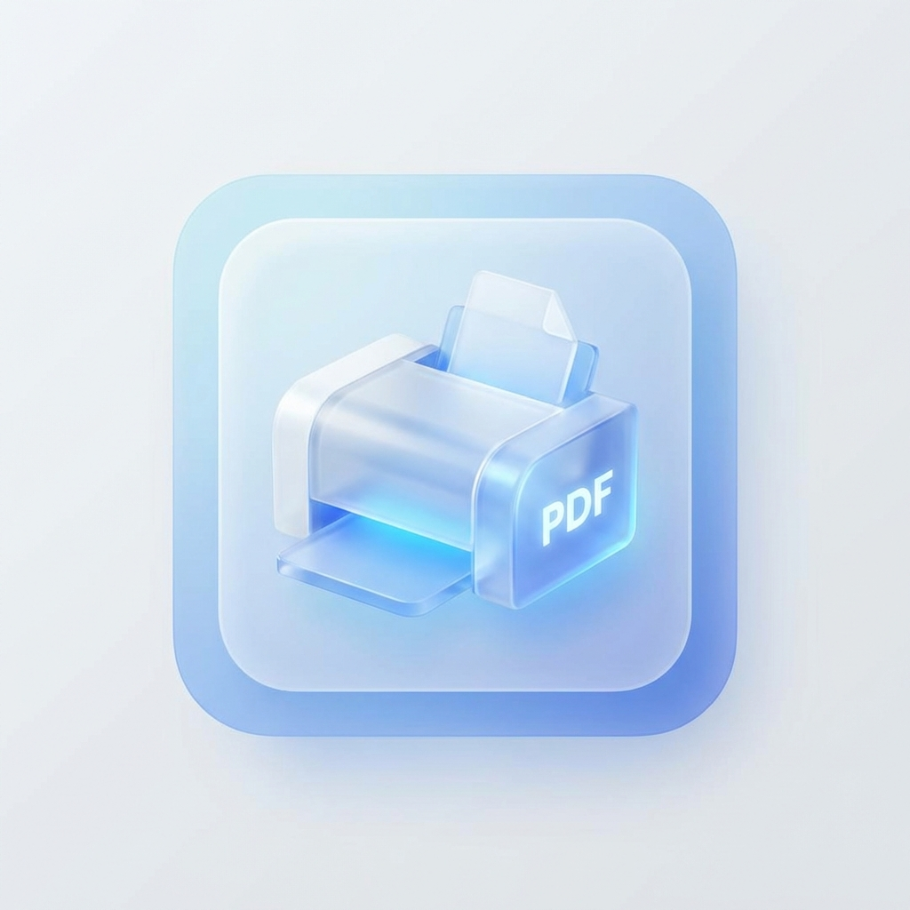

# 自動印刷アプリ かんたん設定・使い方ガイド（スタッフ向け）

## 1. アプリが動いているか確認する

このアプリのアイコンは、このマークです：



画面右下の時計の近く（タスクトレイ）に、このアイコンが出ていれば**動いています**。

隠れている場合は、時計の左にある **「∧」（上向きの矢印）** をクリックすると、隠れているアイコンが表示されます。

**アイコンが見当たらないとき** → 「6. 困ったとき」の「アプリが起動していない」を見てください。

---

## 2. プリンターの設定（いちばん大事）

印刷先のプリンターは、**トレイアイコンを右クリック**するだけで選べます。**ファイルを編集する必要はありません。**

### 手順

1. タスクトレイのアプリのアイコンを **右クリック**
2. メニューが開きます（下の図のような内容）

```
┌─────────────────────────────┐
│  A4/A5 Printer            ▶ │   ← 質札（A4・A5）用のプリンター
│  管理票 Printer           ▶ │   ← 管理票（ラベル）用のプリンター
│  ─────────────────────────  │
│  Quit                       │   ← アプリを終了
└─────────────────────────────┘
```

3. 設定したい方にマウスを合わせると、プリンターの一覧（▶の先）が開きます
4. 使いたいプリンターを**クリック**すると、チェック（●）が付いて設定完了です

### A4/A5 Printer（質札用）

質札（ファイル名に `PRINT_A4` `PRINT_A5` が付くもの）を印刷するプリンターです。

```
A4/A5 Printer ▶
   ┌──────────────────────────────────────┐
   │ ● Default Printer（通常使うプリンター）│
   │   A4白黒印刷 Brother HL-L5210DW series │ ← これを選ぶ例
   │   カラーコピー Brother MFC-L8610CDW    │
   │   Microsoft Print to PDF               │
   └──────────────────────────────────────┘
```

- 普段使うプリンターでよければ **「Default Printer」** のままでOK
- 特定のプリンターに出したいときは、その**プリンター名をクリック**

### 管理票 Printer（管理票・ラベル用）

管理票（ファイル名が `管理票…` のもの）を印刷する**ラベルプリンター**です。

```
管理票 Printer ▶
   ┌──────────────────────────────────────┐
   │   (未設定)                             │
   │ ● 管理表最新                           │ ← ラベルプリンターを選ぶ
   │   A4白黒印刷 Brother HL-L5210DW series │
   └──────────────────────────────────────┘
```

- ここで**ラベルプリンターを選ぶ**（例：QL-820NWB のラベルプリンター）
- 「(未設定)」のままだと管理票は印刷されないので、必ず選んでください

> ⚠️ **大事なポイント**
> 一覧に出るプリンター名は**ぴったり一致**している必要があります。一覧から**クリックで選ぶ**のがいちばん確実です（手で打つと間違いのもと）。

---

## 3. 印刷のテスト

設定できたら、実際に印刷されるか試してみましょう。

1. 普段どおり質札を1件 成約する（または、ファイル名に `PRINT_A4` を含むPDFをダウンロードフォルダに置く）
2. 自動でプリンターから印刷されればOKです 🎉

うまくいかないときは「6. 困ったとき」を見てください。

---

## 4. 毎日の使い方

基本は **何もしなくてOK**。パソコンを起動すれば自動で待機し、成約すれば自動で印刷されます。

| やりたいこと | 操作 |
|---|---|
| 普通に使う | 何もしなくてOK（自動で動いています） |
| アプリを止めたい | トレイアイコンを右クリック →「Quit」 |
| もう一度動かしたい | デスクトップ／フォルダの `start_hidden.vbs` をダブルクリック |
| パソコンを再起動した | 自動でまた動き出します（操作不要） |

---

## 5. 印刷されるファイルのルール

ダウンロードフォルダに入ったファイルのうち、**名前で印刷対象が決まります**。

| ファイル名 | 印刷先 |
|---|---|
| `〇〇PRINT_A4〇〇.pdf` / `.html` | A4/A5 Printer（A4サイズ） |
| `〇〇PRINT_A5〇〇.pdf` / `.html` | A4/A5 Printer（A5サイズ） |
| `管理票〇〇.html` / `.pdf` | 管理票 Printer（ラベル） |

上記以外の名前のファイルは**印刷されません**（無視されます）。

---

## 6. 困ったとき（かんたん対処）

### 印刷されない

1. **トレイにアイコンがあるか**確認（「1.」を参照）。なければ下の「アプリが起動していない」へ
2. **ファイル名**に `PRINT_A4` / `PRINT_A5` / `管理票` が入っているか確認
3. **プリンターが選ばれているか**確認（「2.」を参照。特に管理票は「(未設定)」になっていないか）
4. **プリンターの電源・接続・用紙**を確認
5. それでも直らないときは、アプリを**最新版に更新**してみてください（「8.」を参照）

### 印刷が遅い／たまる

- プリンターが**オフライン・用紙切れ・エラー**になっていないか確認してください
- Windowsの「プリンターとスキャナー」で、そのプリンターが「オフライン」になっていないか確認

### アプリが起動していない（トレイにアイコンがない）

1. インストールフォルダを開く
   - 場所：「ドキュメント」フォルダの中の `pawn-auto-printer`（以前から使っているパソコンは `C:\Program Files (x86)\pawn-auto-printer\dev\pawn-auto-printer`）
2. **`start_hidden.vbs`** をダブルクリック
3. トレイにアイコンが出れば復活です
4. それでも出ない場合は、IT担当に連絡してください

### パソコン起動時に自動で立ち上げる（最初に一度だけ）

毎回手動で起動しなくてよいように、PCを起動したら自動でアプリが立ち上がるよう設定します。**一度やれば、以降はずっと自動で起動**します。

1. エクスプローラーのアドレスバーに、次を貼り付けて Enter（「スタートアップ」フォルダが開きます）：
   ```
   %AppData%\Microsoft\Windows\Start Menu\Programs\Startup
   ```
2. インストールフォルダ（上記の場所）の **`start_hidden.vbs`** を右クリック →「**コピー**」
3. 開いた「Startup」フォルダの中で右クリック →「**ショートカットの貼り付け**」

> ⚠️ 必ず「**ショートカットの貼り付け**」を選んでください（ただの「貼り付け」だと、ファイル本体が移動してしまいます）。

設定できたら、一度PCを再起動して、トレイにアイコンが出れば成功です。

### パソコン起動時にエラーのメッセージが出る（フォルダを移動したあと）

下のような「**スクリプト ファイル … start_hidden.vbs が見つかりません**」というエラーが、PC起動時に出ることがあります。

> 📷 _画像を入れる場所：起動時のエラーメッセージ_
> ``

**原因：** アプリのフォルダを**移動した**のに、自動起動の登録が**古い場所を指したまま**になっているためです（アプリ自体は別の登録で起動していることが多いです）。

**直し方（古い登録を消す）：**

1. エクスプローラーのアドレスバーに貼り付けて Enter：
   ```
   %AppData%\Microsoft\Windows\Start Menu\Programs\Startup
   ```
2. 中のショートカットを右クリック →「プロパティ」で「**リンク先**」を確認
3. **古い場所**を指しているショートカットを**削除**（今のフォルダを指すものは残す）
4. それでも出る場合は、スタートメニューで「**タスク スケジューラ**」を開き、「タスク スケジューラ ライブラリ」の中の **`PDFAutoPrinter`** を右クリック →「削除」

> この作業が不安な場合は、IT担当にこのページを見せて対応してもらってください。

---

## 7. ふだんは触らない設定（上級者・IT担当向け）

通常のプリンター設定は「2.」のトレイメニューだけで完結します。
以下の `config.json`（設定ファイル）は**普段は編集しないでください**。編集を間違えるとアプリが動かなくなることがあります。

必要な場合のみ、`config.json` をメモ帳で開いて編集します（**保存は UTF-8 のまま**）。

| 項目 | 意味 | 備考 |
|---|---|---|
| `target_printer` | 質札用プリンター | 通常はトレイメニューで設定（手編集不要） |
| `kanrihyo_printer` | 管理票用プリンター | 通常はトレイメニューで設定（手編集不要） |
| `kanrihyo_paper_size` | 管理票の用紙サイズ | 例：`62mm`。空にするとプリンター既定 |
| `watch_directory` | 監視するフォルダ | 空ならダウンロードフォルダ |

> 設定を変えたら、アプリを再起動（トレイ →「Quit」→ `start_hidden.vbs`）すると反映されます。

---

## 8. アプリの更新（IT担当向け）

**アプリは起動したときと毎日20時に、自動で最新版に更新されます。** ふだんは何もする必要はありません。

- **毎日20時のメンテナンス**：スリープ中でもパソコンを起こして、更新の確認と、印刷できずに残った古いファイル（`PRINT_A4`・`PRINT_A5`・`管理票` のうち1時間より前のもの）の削除をします。入れ替えは印刷していないときに行います。パソコンを起こせなかったときは、次にパソコンが起きたときに行います
- **どのパソコンが最新か**：各パソコンのアプリが、起動時と毎日20時に状況（PC名・バージョン・場所・自動更新の可否）を自動で報告します。Googleドライブのスプレッドシート「**自動印刷アプリ 状況報告（回答）**」の「PCごとの最新」シートで、パソコンごとの最新の状況を確認できます

### 今すぐ更新したいとき／自動更新が入る前の古いアプリのとき

どのパソコンでも、同じコマンドを1行貼り付けるだけで更新できます。アプリの保存場所は自動で探すので、フォルダを開く必要はありません。

1. スタートボタンを右クリック →「**Windows PowerShell**」（Windows 11 では「**ターミナル**」）を開く（**「管理者として実行」は選ばずに**、普通に開いてください）
2. 次のコマンドをコピーして貼り付け（右クリックまたは Ctrl+V）、Enter：
   ```
   [Net.ServicePointManager]::SecurityProtocol='Tls12'; irm https://raw.githubusercontent.com/assist-grp/pawn-auto-printer/main/update.ps1 | iex
   ```
3. 最後に `VERSION: …` の行と「**Done.**」が表示されれば完了です。アプリは自動で再起動されるので、**アプリやパソコンの再起動は不要**です。あわせて、下の「自動更新できるかの確認」の表示も見てください

> - アプリを動かしている Windows ユーザーでサインインして実行してください（ユーザーごとに必要です）
> - 印刷していないときに実行してください（再起動の瞬間に届いたファイルは印刷されないことがあります）
> - プリンター設定（`config.json`）は変更されません
> - `[ERROR]` や、下の表にない `[WARN]` が表示されたときは、画面の文字をそのままコピーして IT担当に送ってください

### 自動更新できるかの確認（更新コマンドの結果を見る）

アプリは管理者権限なしで動くため、アプリのフォルダに書き込めないと自動更新が失敗し、古い版のまま動き続けます（`C:\Program Files (x86)` の下は、ふつうは書き込めません）。上の更新コマンドはこの確認も一緒に行うので、表示された結果を見てください。

| 表示 | 意味・やること |
|---|---|
| `[OK] auto-update can write to this folder` | 問題ありません。今後も自動で更新されます |
| `[WARN] auto-update CANNOT write to this folder` | このフォルダでは自動更新ができません。下の「アプリのフォルダを移す」の手順で移してください（※ Program Files に置いているパソコンは移さずにそのまま使います。その場合は自動更新されないので、更新したいときは PowerShell を「管理者として実行」で開いて更新コマンドを実行してください） |
| `[NOTE] The app is inside the Downloads folder` | アプリがダウンロードフォルダの中にあります。整理したときに消してしまわないよう、下の「アプリのフォルダを移す」の手順で移してください |
| `[NOTE] PowerShell is running as administrator` | 管理者として開いたため確認できていません。PowerShell を**普通に**開き直して、もう一度実行してください |

### アプリのフォルダを移す（ダウンロードフォルダにあるとき／自動更新ができないと表示されたとき）

次のコマンドで、アプリを**「ドキュメント」フォルダの中**（例：`C:\Users\（ユーザー名）\Documents\pawn-auto-printer`）へ自動で移せます。プリンター設定・自動起動・ショートカットもそのまま引き継がれます。

1. PowerShell を**普通に**開く（「管理者として実行」は選ばない）
2. 次のコマンドをコピーして貼り付け、Enter：
   ```
   [Net.ServicePointManager]::SecurityProtocol='Tls12'; irm https://raw.githubusercontent.com/assist-grp/pawn-auto-printer/main/move_to_documents.ps1 | iex
   ```
3. 途中で「**このアプリがデバイスに変更を加えることを許可しますか？**」と出たら「**はい**」（自動起動の登録とウイルス対策の除外設定を、新しい場所に合わせるためです）
4. 最後に「**Done.**」と表示されれば完了。古いフォルダは自動で削除されます

> **このコマンドがすること：** アプリを止めて、フォルダごと（プリンター設定の `config.json` も）「ドキュメント」へコピー → 自動起動・ショートカット・ウイルス対策の除外設定を新しい場所に合わせる → 新しい場所で起動できたことを確かめてから、古いフォルダを削除します。
> アプリが **Program Files** にある場合や、すでに「ドキュメント」にある場合は、何もしません。

**手作業で移す場合（コマンドが使えないとき）：**

1. タスクトレイのアイコンを右クリック →「Quit」で、アプリを止める
2. エクスプローラーの左側の「**ドキュメント**」を開き、その中に `pawn-auto-printer` フォルダを作って、今のアプリのフォルダの**中身を全部コピー**する（`config.json` も一緒にコピーすれば、プリンター設定はそのまま使えます）
3. 新しいフォルダの `register_autostart.bat` を右クリック →「**管理者として実行**」（自動起動の登録し直し。アプリも起動します）
4. スタートアップに**古い場所**を指すショートカットが残っていれば削除する（アドレスバーに `shell:startup` と入力して Enter で開けます。手順は「6.」の「パソコン起動時にエラーのメッセージが出る」と同じ）。デスクトップのショートカットも、新しいフォルダの `create_desktop_shortcut.bat` で作り直す
5. 上の更新コマンドをもう一度実行し、`[OK] auto-update can write to this folder` と出れば完了。古いフォルダは削除してかまいません

---

## こまったら

- 動作の記録は `printer_log.txt`（インストールフォルダ内）に残っています。トラブル時はこのファイルを IT担当に見せると原因が分かりやすくなります。
- インストールや詳しい不具合対応は **INSTALL_JP.md** を参照してください。

---
